<div align="center">

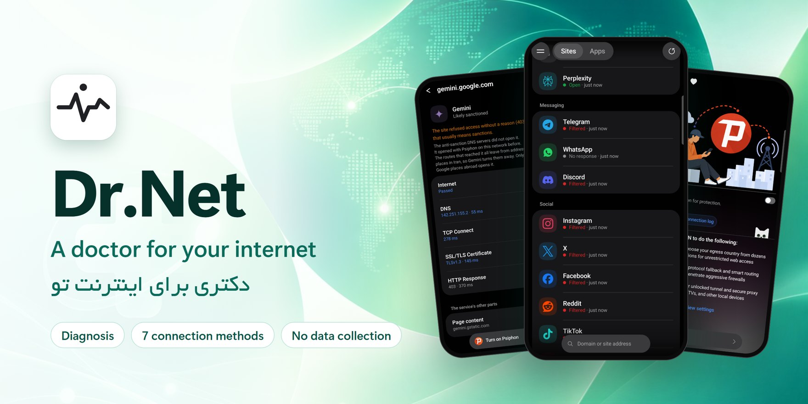

[English](README.md) | **فارسی**

[](https://github.com/msnuoy/drnet-releases/releases/latest)
[](#download)
[](#faq)
[](#privacy)
[](https://t.me/NURREVEAL)

</div>

وقتی سایتی باز نمی‌شود، کسی نمی‌گوید چرا. فیلتر است؟ تحریم است؟ یا خود اینترنت مشکل دارد؟

برنامه‌ی **Dr.Net** دقیقاً همین را می‌گوید و بعد، با یک لمس، درستش می‌کند. سایت‌ها و برنامه‌ها را لایه‌به‌لایه بررسی می‌کند، راهی را که روی شبکه‌ی *خود شما* واقعاً کار می‌کند پیدا می‌کند و از همان راه وصلتان می‌کند: با یازده متود اتصال داخلی، کانفیگ‌های خودتان، و ابزارهایی که اصلاً سرور لازم ندارند. رایگان است، تبلیغ ندارد و هیچ اطلاعاتی از شما جمع نمی‌کند.

<p align="center">
  <a href="https://github.com/msnuoy/drnet-releases/releases/latest"></a>
</p>

<p align="center" dir="rtl">
  <a href="#download">دانلود</a> ·
  <a href="#features">قابلیت‌ها</a> ·
  <a href="#install">نصب</a> ·
  <a href="#verify">بررسی اصل بودن</a> ·
  <a href="#privacy">حریم خصوصی</a> ·
  <a href="#faq">پرسش‌های رایج</a> ·
  <a href="#contact">ارتباط با ما</a>
</p>

## <a id="download"></a>دانلود

آخرین فایل نصب را از بخش **[Releases](https://github.com/msnuoy/drnet-releases/releases/latest)** بگیرید. برنامه به **اندروید ۸ یا بالاتر** نیاز دارد. هر نسخه چهار فایل نصب دارد؛ فایلی را بردارید که به گوشی‌تان می‌خورد:

<div dir="rtl">

| فایل | برای |
| --- | --- |
| `Dr.Net-<version>-arm64-v8a.apk` | **بیشتر گوشی‌های ساخت حدود ۲۰۱۷ به بعد. اگر مطمئن نیستید، همین را بگیرید.** |
| `Dr.Net-<version>-armeabi-v7a.apk` | گوشی‌های قدیمی‌تر، و گوشی‌های ارزانی که اندروید ۳۲ بیتی دارند |
| `Dr.Net-<version>-universal.apk` | همه‌ی گوشی‌ها، ولی با حدود دو برابر حجم |
| `Dr.Net-<version>-x86_64.apk` | شبیه‌سازهای کامپیوتر و دستگاه‌های اندرویدی با پردازنده‌ی Intel یا AMD |
| `SHA256SUMS.txt` | کد بررسی فایل‌ها، برای [اطمینان از اصل بودن فایل](#verify) |

</div>

> **نکته:** اگر اندروید با فایل arm64-v8a پیغام **«برنامه نصب نشد»** داد، گوشی شما اندروید ۳۲ بیتی دارد؛ به‌جایش armeabi-v7a را نصب کنید. با کامپیوتر هم می‌شود مستقیم از خود گوشی پرسید:
>
> ```bash
> adb shell getprop ro.product.cpu.abi
> ```

## <a id="features"></a>قابلیت‌ها

### تشخیص هوشمند: چرا سایت باز نمی‌شود

- سایت یا برنامه را لایه‌به‌لایه بررسی می‌کند (اینترنت، DNS، TCP، TLS، HTTP) و به زبان ساده می‌گوید مشکل کجاست: فیلتر، تحریم، یا خود اتصال.
- همان لحظه اولین راهی را که واقعاً بازش می‌کند پیشنهاد می‌دهد و بعد دنبال راه بهتر می‌گردد.
- اختلال را هم تشخیص می‌دهد: صفحه‌ای که شروع به باز شدن می‌کند و نیمه‌کاره قطع می‌شود.
- نتیجه‌ها را برای هر شبکه جدا نگه می‌دارد (وای‌فای، همراه اول، ایرانسل…) و یادش می‌ماند روی هر شبکه کدام متود بهتر کار کرده.
- فهرست آماده‌ی سایت‌ها و برنامه‌های پرکاربرد (هوش مصنوعی، پیام‌رسان، شبکه‌های اجتماعی و…)، به‌علاوه‌ی هر آدرسی که خودتان بنویسید.

<p align="center" dir="rtl">
  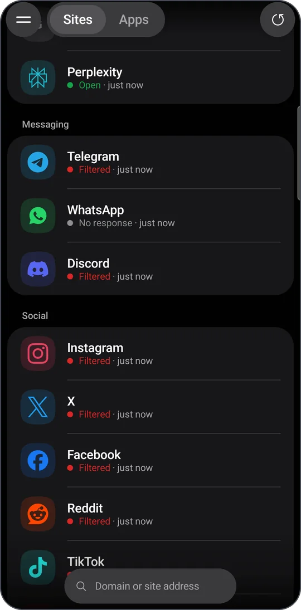
  &nbsp;
  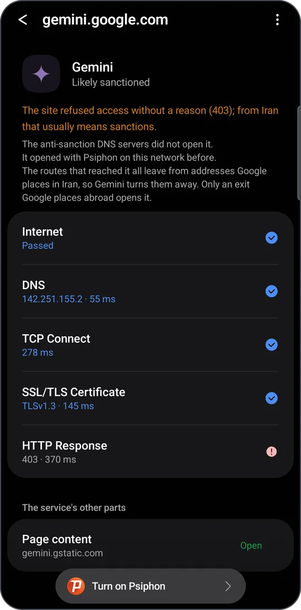
</p>
<p align="center" dir="rtl"><sub>بررسی سایت‌ها روی ایرانسل · یک سایت، لایه‌به‌لایه، همراه با راه‌حل</sub></p>

### یازده متود اتصال

همه داخل خود برنامه‌اند و چیز دیگری لازم نیست نصب کنید. یکی را انتخاب کنید، یا بگذارید «تشخیص» بگوید کدام روی شبکه‌ی شما کار می‌کند.

<div dir="rtl">

| متود | چیست |
| --- | --- |
| **لنترن** (Lantern) | شبکه‌ی ضدسانسور لنترن، با انتخاب کشور |
| **آمنزیا** (AmneziaWG) | وایرگارد با پوشش؛ روی وارپ کلادفلر یا سرور خودتان |
| **تور** (Tor) | شبکه‌ی امن تور، همراه با پل‌های obfs4 و Snowflake |
| **سایفون** (Psiphon) | شبکه‌ی ضدسانسور سایفون، با انتخاب کشور |
| **وارپ در وارپ** (WARP-on-WARP) | تانل دولایه‌ی وارپ در وارپ |
| **وایرگارد** (WireGuard) | اتصال مستقیم و پرسرعت وایرگارد |
| **ماسک** (MASQUE) | ترابری HTTP/3 و HTTP/2 بر بستر کلادفلر |
| **آرگو** (Argo) | سرورهای خود آرگو: پل‌ها، فالکن‌ها و سرورهای عمومی |
| **فنیکس** (Fenix) | وی‌پی‌ان رایگان فایرفاکس با ۵۰ گیگابایت برای هر حساب و سرورهایی در بیش از ۳۰ کشور |
| **وی‌پی‌ان گیت** (VPN Gate) | رله‌های داوطلبانه در سراسر دنیا، با انتخاب کشور |
| **مامی** (Mami) | فهرست مامی، پل اختصاصی گوشی و سرورهای Lion |

</div>

<p align="center" dir="rtl">
  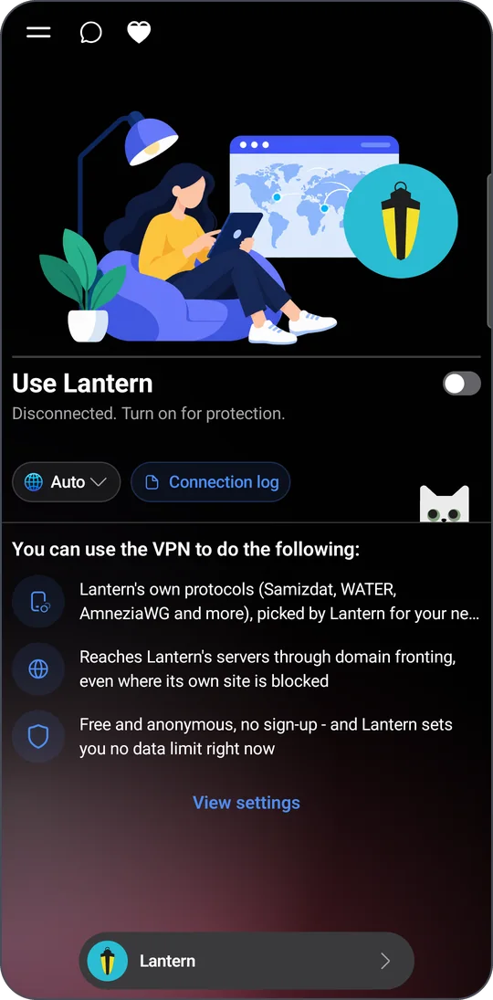
  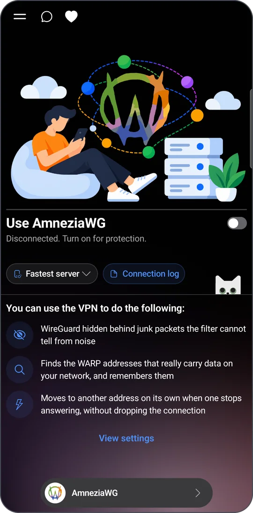
  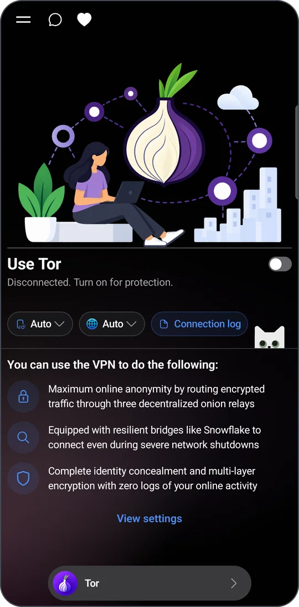
  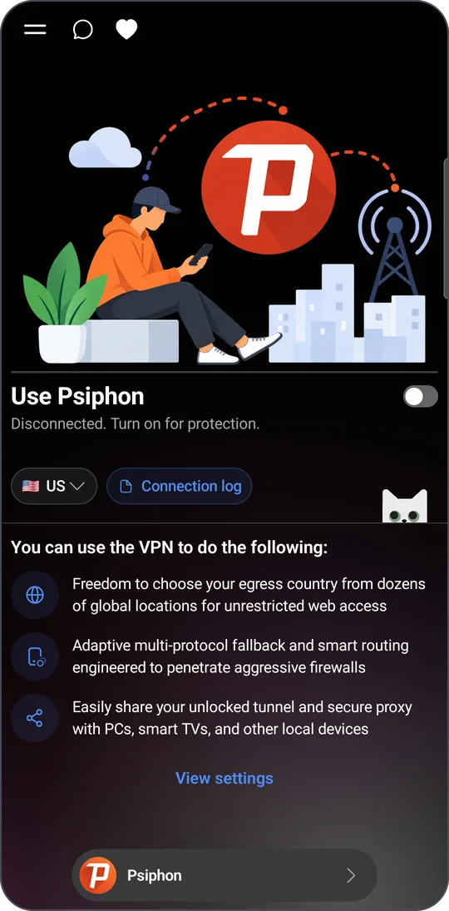
</p>
<p align="center" dir="rtl">
  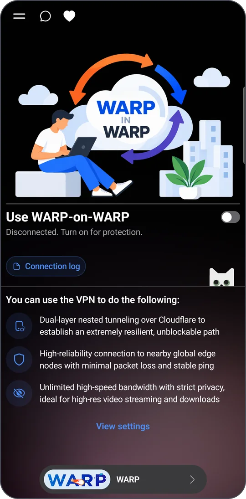
  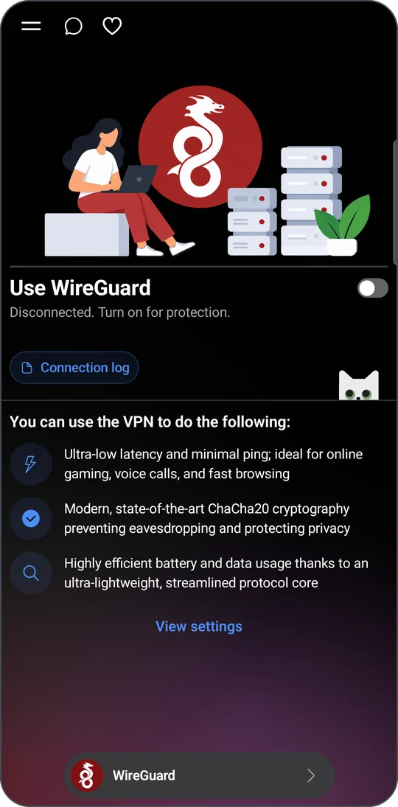
  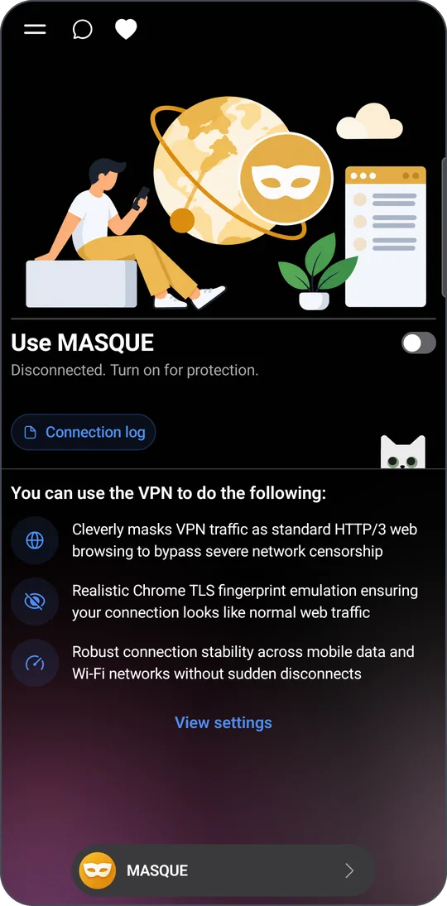
</p>
<p align="center" dir="rtl">
  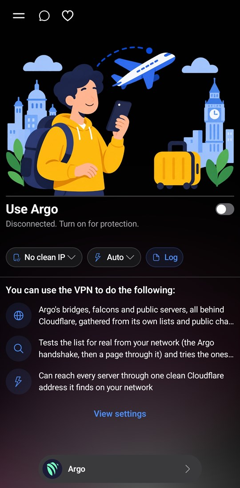
  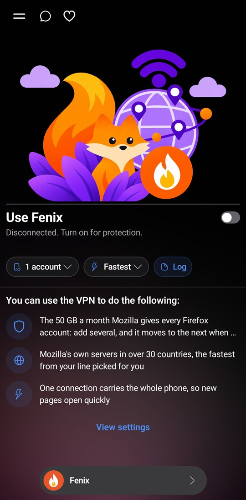
  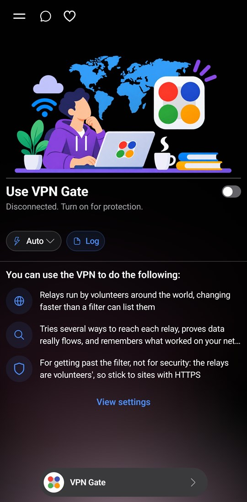
  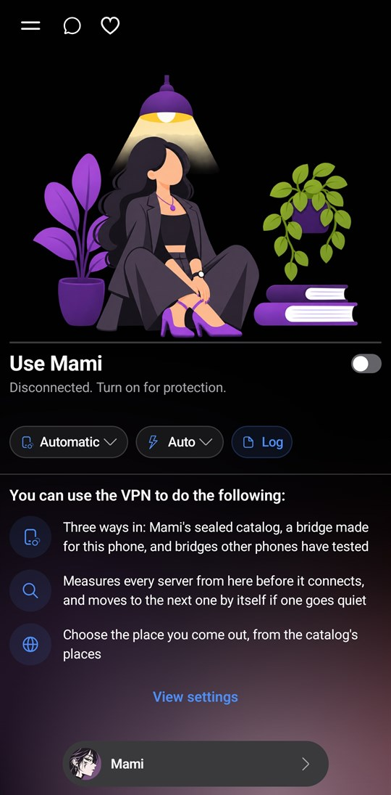
</p>

### ابزارهای بدون سرور

- **رله گوگل**: مرورگر شما از راه یک اسکریپت گوگل که خودتان در حساب گوگل خودتان می‌سازید به اینترنت می‌رسد. راه‌اندازی‌اش حدود پنج دقیقه طول می‌کشد؛ برنامه سهمیه‌ی روزانه را نشان می‌دهد و قبل از رسیدن به سقف خبرتان می‌کند.
- **دامین فرانتینگ**: سایت‌های فیلترشده مثل گوگل، یوتیوب و اینستاگرام را با یک نام تمیز در کروم باز می‌کند. گواهی‌اش روی خود گوشی ساخته می‌شود و کلیدش هیچ‌وقت از گوشی بیرون نمی‌رود.
- **DNS**: ده‌ها DNS را روی شبکه‌ی شما تست می‌کند (عمومی، ضدتحریم، گیمینگ، خانواده…) و از همانی که انتخاب کنید وصلتان می‌کند.
- ابزارهای پرکاربردتان را با **+** به منو اضافه کنید.

<p align="center" dir="rtl">
  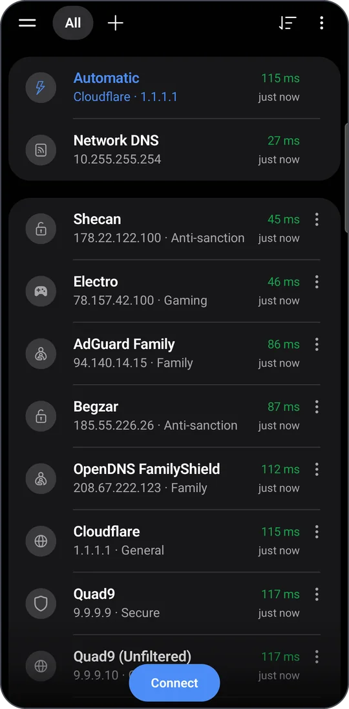
  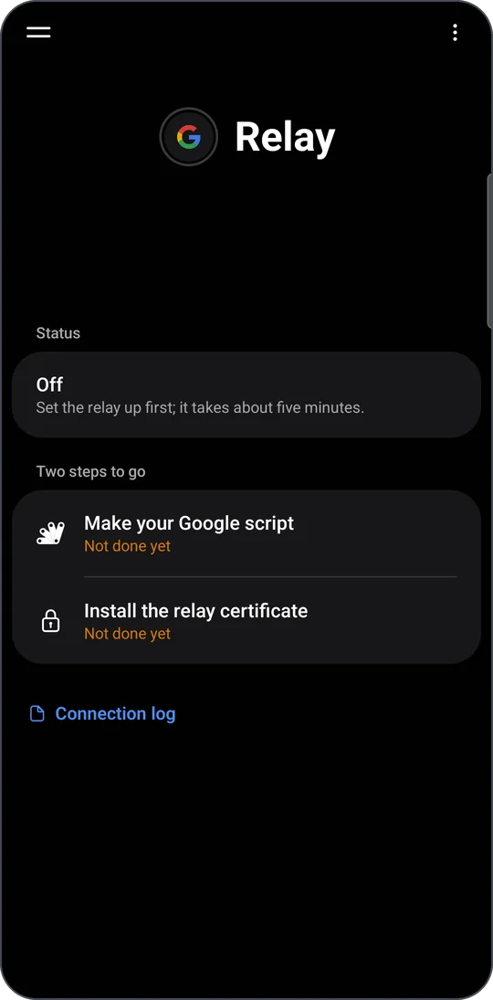
  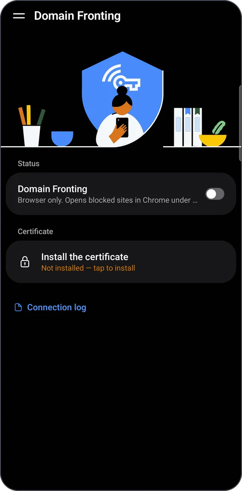
</p>
<p align="center" dir="rtl"><sub>تست DNS · رله گوگل · دامین فرانتینگ</sub></p>

### کانفیگ و سرور خودتان

- کانفیگ‌ها و لینک‌های اشتراک خودتان را اضافه کنید، تأخیر واقعی‌شان را تست کنید و با یک لمس وصل شوید.
- روی حساب Cloudflare **خودتان** یک ورکر سبک و سریع بسازید؛ کلیدهایتان روی گوشی خودتان می‌ماند.
- با اسکنر آی‌پی تمیز، آدرس‌هایی از Cloudflare را پیدا کنید که روی شبکه‌ی شما کار می‌کنند.
- کانفیگ‌های رایگان عمومی هم هست، فقط اگر خودتان اضافه‌شان کنید.

### برای استفاده‌ی هرروزه

- قطع‌کن اضطراری که با همه‌ی متودها و کانفیگ‌ها کار می‌کند.
- انتخاب کنید کدام برنامه‌ها از تونل بروند: همه، فقط برنامه‌های انتخاب‌شده، یا همه به‌جز آن‌ها (مثلاً برای برنامه‌های بانکی).
- وصل دوباره وقتی اتصال قطع شد، و وصل بعد از ری‌استارت یا آپدیت؛ هر دو خاموش‌اند تا خودتان روشنشان کنید.
- کاشی تنظیمات سریع (Quick Settings)، و میان‌بر روی صفحه‌ی اصلی گوشی.
- گزارش اتصال برای هر متود، با مصرف داده به تفکیک هفته و ماه.
- به‌روزرسانی از داخل خود برنامه، حتی از داخل تونل.
- فارسی و انگلیسی، روشن و تیره.

## <a id="install"></a>نصب

1. فایل مناسب گوشی‌تان را از [Releases](https://github.com/msnuoy/drnet-releases/releases/latest) دانلود کنید.
2. از بخش دانلودهای مرورگر یا با یک فایل‌منیجر بازش کنید. اگر اندروید پرسید، اجازه‌ی نصب برنامه از همان منبع را بدهید.
3. **نصب** و بعد **باز کردن** را بزنید.

از آن به بعد خود برنامه این صفحه را چک می‌کند و هر نسخه‌ی جدید را داخل برنامه پیشنهاد می‌دهد.

> **توجه:** برنامه در گوگل‌پلی نیست، برای همین ممکن است Play Protect پیشنهاد اسکن بدهد یا بگوید سازنده را نمی‌شناسد. این برای برنامه‌هایی که بیرون از Play Store نصب می‌شوند عادی است.

## <a id="verify"></a>مطمئن شوید نسخه‌ی شما اصل است

نسخه‌های دستکاری‌شده‌ی برنامه‌های VPN در تلگرام دست‌به‌دست می‌شوند. برنامه را فقط از همین صفحه یا از به‌روزرسانی داخل خود برنامه بگیرید، و اگر فایل از جای دیگری به دستتان رسیده، قبل از نصب بررسی‌اش کنید.

### ۱. کد بررسی (Checksum)

فایل `SHA256SUMS.txt` را کنار فایل نصب بگذارید و یکی از این‌ها را اجرا کنید. جلوی هر فایلی که دارید باید `OK` بیاید.

**ویندوز (PowerShell)**

```powershell
Get-Content .\SHA256SUMS.txt | ForEach-Object {
    $hash, $file = $_ -split ' \*'
    if (Test-Path $file) {
        $ok = (Get-FileHash $file -Algorithm SHA256).Hash -eq $hash
        "$file  $(if ($ok) { 'OK' } else { 'FAILED' })"
    }
}
```

**لینوکس، یا Termux روی اندروید**

```bash
sha256sum --check --ignore-missing SHA256SUMS.txt
```

**مک**

```bash
shasum -a 256 --check --ignore-missing SHA256SUMS.txt
```

### ۲. گواهی امضا

فایل‌های نصب این صفحه با این گواهی امضا شده‌اند (`CN=Dr.Net`):

```text
SHA-256: 79:D5:A8:52:56:54:E6:D7:BB:0A:73:FE:46:8C:40:87:E8:BD:F0:B7:5E:5D:D3:59:EC:E3:0D:62:24:B9:1C:AA
```

برای بررسی یک فایل، از `apksigner` در build tools اندروید استفاده کنید:

```bash
apksigner verify --print-certs Dr.Net-*-arm64-v8a.apk
```

خط `Signer #1 certificate SHA-256 digest` باید این باشد: `79d5a8525654e6d7bb0a73fe468c4087e8bdf0b75e5dd359ece30d6224b91caa`

خود اندروید هم این را چک می‌کند: به‌روزرسانی فقط وقتی روی برنامه‌ی شما نصب می‌شود که با همان کلید امضا شده باشد.

## <a id="privacy"></a>حریم خصوصی

برنامه‌ی Dr.Net هیچ اطلاعاتی از شما جمع نمی‌کند و جایی نمی‌فرستد.

- هیچ ابزار آمار، ردیابی یا تبلیغ ندارد، و حساب کاربری هم ندارد.
- هیچ شناسه‌ای از گوشی خوانده نمی‌شود: نه IMEI، نه شماره تلفن، نه ANDROID_ID، نه حساب‌های گوگل، نه مخاطبین.
- در همه‌ی متودها DNS داخل تونل می‌ماند و IPv6 هم نمی‌تواند از کنار تونل بیرون برود.
- گزارش اتصال فقط در حافظه‌ی برنامه است و نسخه‌ی منتشرشده اسم سایت‌ها و آدرس‌ها را در آن ثبت نمی‌کند.
- «گزارش مشکل» تلگرام را با پیامی باز می‌کند که قبل از فرستادن می‌بینید؛ لینک‌ها، کلیدها و شناسه‌ها از آن حذف شده‌اند.
- کانفیگ‌ها، تنظیمات و کلیدهای حساب فقط روی گوشی خودتان می‌مانند، با Keystore اندروید رمز می‌شوند، و چیزی از برنامه در پشتیبان‌گیری گوگل نمی‌رود.

همه‌ی جزئیات، از جمله هر آدرسی که خود برنامه به آن وصل می‌شود، در **[PRIVACY.md](PRIVACY.md)** آمده است.

## <a id="faq"></a>پرسش‌های رایج

<details dir="rtl">
<summary><b>برنامه واقعاً رایگان است؟</b></summary>

بله. نه تبلیغ دارد، نه اشتراک، نه حساب کاربری.

</details>

<details dir="rtl">
<summary><b>از کدام متود استفاده کنم؟</b></summary>

از «تشخیص» شروع کنید: نشان می‌دهد چه چیزی روی شبکه‌ی شما بسته است و از چه راهی باز می‌شود. برنامه همچنین یادش می‌ماند روی هر شبکه کدام متود بهتر کار کرده و آن را بالای صفحه‌ی تشخیص نشان می‌دهد.

</details>

<details dir="rtl">
<summary><b>به روت نیاز دارد؟</b></summary>

نه. برنامه از سرویس VPN استاندارد اندروید استفاده می‌کند و تا وقتی وصل است، اندروید آیکون کلید را نشان می‌دهد.

</details>

<details dir="rtl">
<summary><b>کسی می‌تواند ببیند چه سایت‌هایی باز می‌کنم؟</b></summary>

خود برنامه نه: هیچ چیزی از وب‌گردی شما به ما نمی‌رسد. ولی مثل هر VPN دیگری، سرورهای متودی که استفاده می‌کنید (سایفون، لنترن، رله‌های تور یا کانفیگ‌های عمومی) می‌بینند به چه سایت‌هایی وصل می‌شوید. HTTPS محتوای صفحه‌ها را رمزشده نگه می‌دارد.

</details>

<details dir="rtl">
<summary><b>اندروید می‌گوید «برنامه نصب نشد». چه کنم؟</b></summary>

معمولاً یکی از این سه است: فایل با گوشی‌تان جور نیست (armeabi-v7a را امتحان کنید)، حافظه‌ی گوشی کم است، یا برنامه‌ای که الان دارید با کلید دیگری امضا شده. در حالت آخر، از کانفیگ‌هایتان پشتیبان بگیرید، آن نسخه را حذف کنید و فایل همین صفحه را نصب کنید.

</details>

<details dir="rtl">
<summary><b>چطور مشکل را گزارش کنم؟</b></summary>

داخل برنامه **گزارش مشکل** را بزنید. تلگرام با یک پیام آماده باز می‌شود (مدل گوشی، نسخه‌ی اندروید، اپراتور، متود و چند خط آخر گزارش اتصال) که قبل از فرستادن می‌توانید بخوانیدش. اینجا هم می‌توانید [Issue باز کنید](https://github.com/msnuoy/drnet-releases/issues).

</details>

## <a id="contact"></a>ارتباط با ما

<div dir="rtl">

| | |
| --- | --- |
| کانال تلگرام | [@NURREVEAL](https://t.me/NURREVEAL): نسخه‌های تازه و آموزش‌ها |
| یوتیوب | [@nurreveal](https://www.youtube.com/@nurreveal) |
| پشتیبانی | [@nurrea](https://t.me/nurrea) در تلگرام |
| گزارش مشکل و پیشنهاد | [Issues](https://github.com/msnuoy/drnet-releases/issues) |

</div>

<br>

<div align="center" dir="rtl">
<sub>ما هم مثل شما هر روز با همین اینترنت سر و کار داریم. اگر Dr.Net به کارتان آمد، به دوستانتان هم معرفی‌اش کنید.</sub>
</div>
