<div align="center">

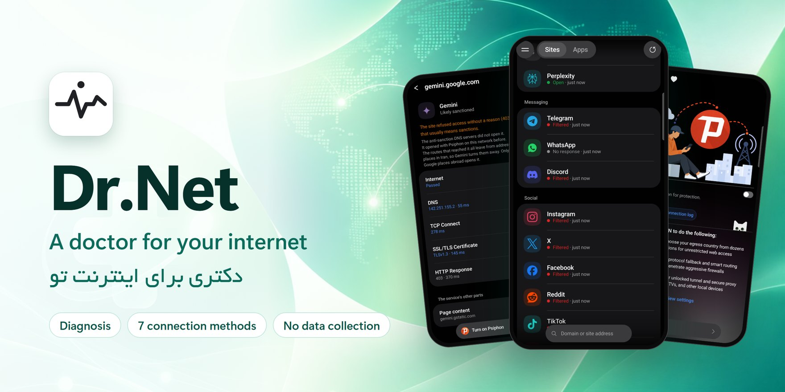

**English** | [فارسی](README.fa.md)

[](https://github.com/msnuoy/drnet-releases/releases/latest)
[](#download)
[](#faq)
[](#privacy)
[](https://t.me/NURREVEAL)

</div>

When a site won't open, nobody tells you why. Is it filtering? Sanctions? The connection itself?

**Dr.Net** tells you exactly that, then fixes it with one tap. It checks sites and apps step by step, finds the route that really works on *your* network, and connects you through it: eleven built-in connection methods, your own configs, and tools that need no server at all. It is free, shows no ads, and collects nothing about you.

<p align="center">
  <a href="https://github.com/msnuoy/drnet-releases/releases/latest"></a>
</p>

<p align="center">
  <a href="#download">Download</a> ·
  <a href="#what-drnet-does">Features</a> ·
  <a href="#install">Install</a> ·
  <a href="#make-sure-your-copy-is-genuine">Verify</a> ·
  <a href="#privacy">Privacy</a> ·
  <a href="#faq">FAQ</a> ·
  <a href="#contact">Contact</a>
</p>

## Download

Get the newest APK from **[Releases](https://github.com/msnuoy/drnet-releases/releases/latest)**. Dr.Net needs **Android 8.0 or newer**. Every release has four APKs; take the one that fits your phone:

| File | For |
| --- | --- |
| `Dr.Net-<version>-arm64-v8a.apk` | **Most phones made since about 2017. If you are not sure, start with this one.** |
| `Dr.Net-<version>-armeabi-v7a.apk` | Older phones, and low-cost phones that run 32-bit Android |
| `Dr.Net-<version>-universal.apk` | Any phone, but about twice the size |
| `Dr.Net-<version>-x86_64.apk` | PC emulators and Android devices with Intel or AMD chips |
| `SHA256SUMS.txt` | Checksums, to [make sure your file is genuine](#make-sure-your-copy-is-genuine) |

> [!TIP]
> If Android says **"App not installed"** with the arm64-v8a file, your phone runs 32-bit Android: use armeabi-v7a instead. With a computer you can ask the phone directly:
>
> ```bash
> adb shell getprop ro.product.cpu.abi
> ```

## What Dr.Net does

### Diagnosis: why a site won't open

- Checks a site or an app layer by layer (internet, DNS, TCP, TLS, HTTP) and says in plain words what is wrong: filtering, sanctions, or the connection itself.
- Offers the first route that really opens it right away, then keeps looking for a better one.
- Catches disruption too: pages that start loading and are then cut off.
- Keeps results for each network separately (Wi-Fi, MCI, Irancell…) and remembers which method works best on each.
- Ready-made lists of popular sites and apps (AI, messaging, social and more), plus any address you type.

<p align="center">
  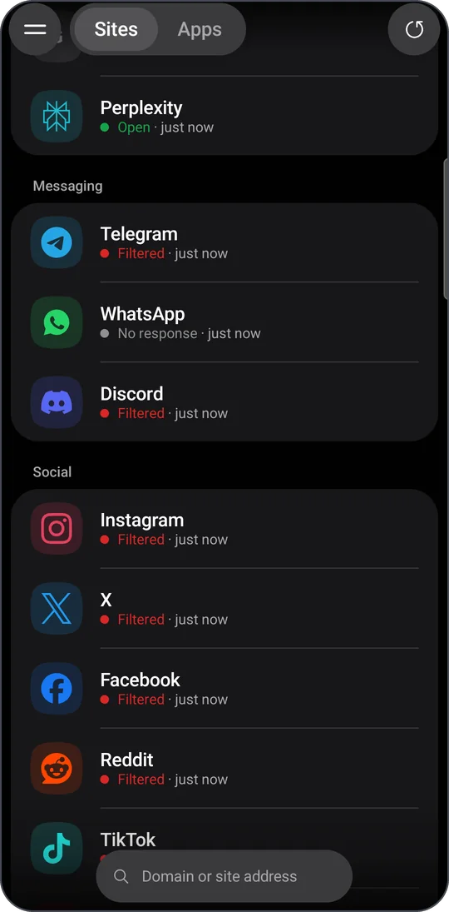
  &nbsp;
  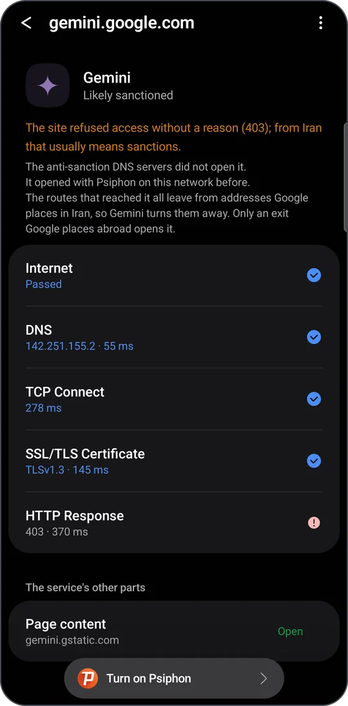
</p>
<p align="center"><sub>Sites checked on Irancell · One site, layer by layer, with the fix</sub></p>

### Eleven connection methods

Built in, nothing else to install. Pick one, or let Diagnosis tell you which works on your network.

| Method | What it is |
| --- | --- |
| **Lantern** | Lantern's anti-censorship network, with country choice |
| **AmneziaWG** | WireGuard in disguise, over Cloudflare WARP or your own server |
| **Tor** | Onion routing with obfs4 and Snowflake bridges |
| **Psiphon** | Censorship circumvention with country choice |
| **WARP-on-WARP** | A two-layer WARP tunnel |
| **WireGuard** | A fast, direct WireGuard tunnel |
| **MASQUE** | HTTP/3 and HTTP/2 transport over Cloudflare |
| **Argo** | Argo's own bridges, falcons and public servers |
| **Fenix** | Firefox's free VPN, with 50 GB per account and servers in 30+ countries |
| **VPN Gate** | Volunteer-run relays around the world, with country choice |
| **Mami** | Mami's catalog, a phone-specific bridge, and Lion |

<p align="center">
  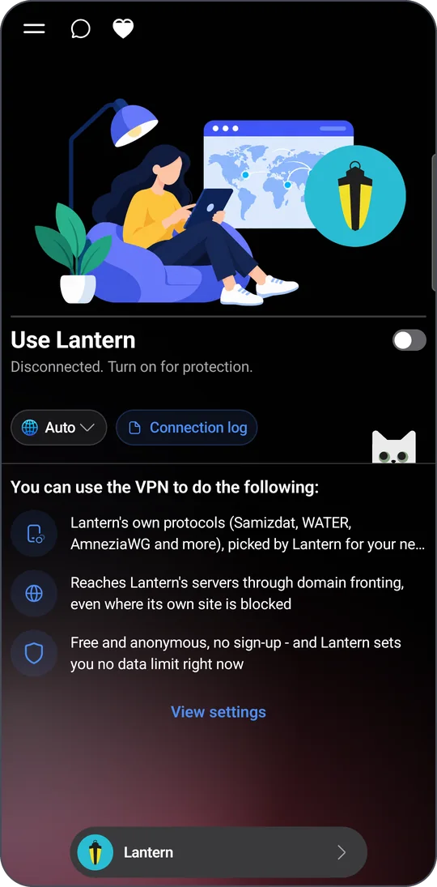
  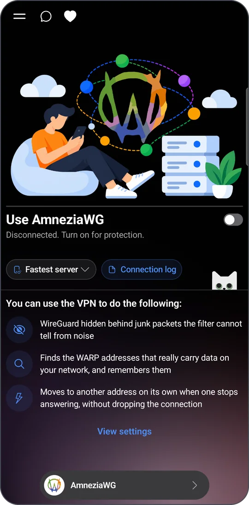
  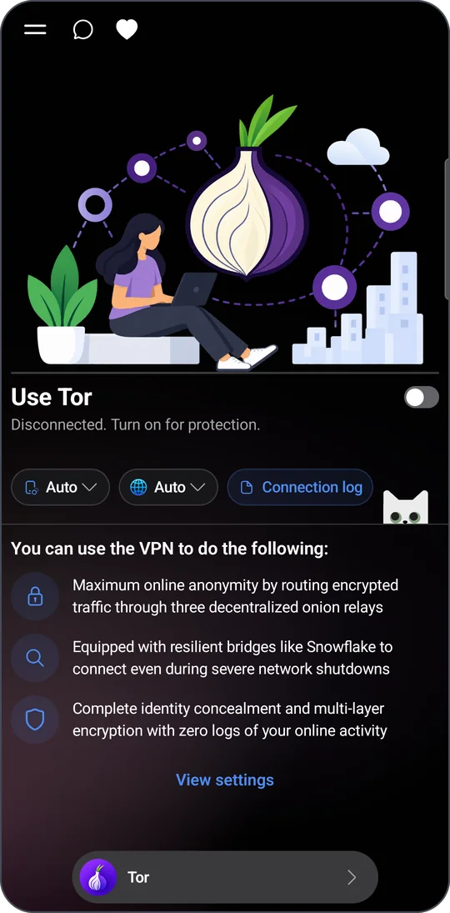
  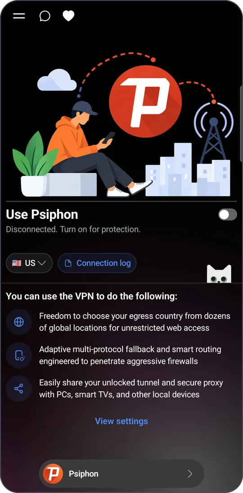
</p>
<p align="center">
  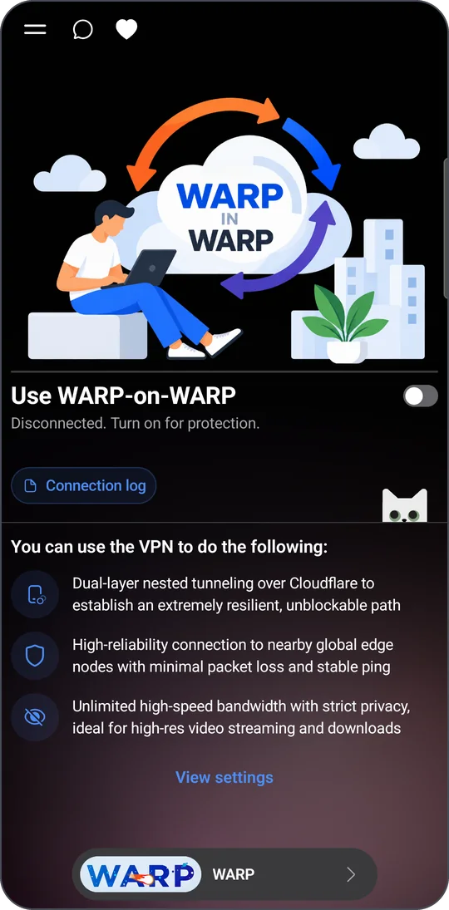
  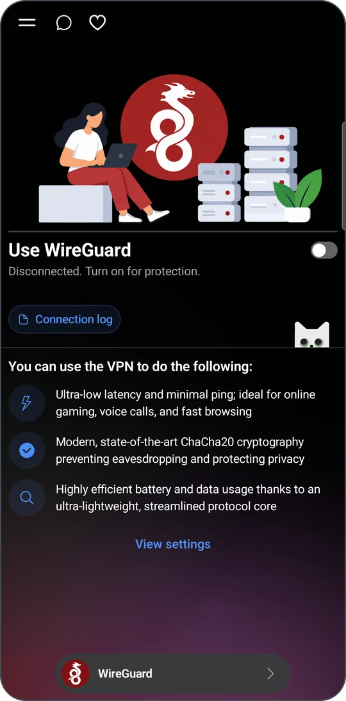
  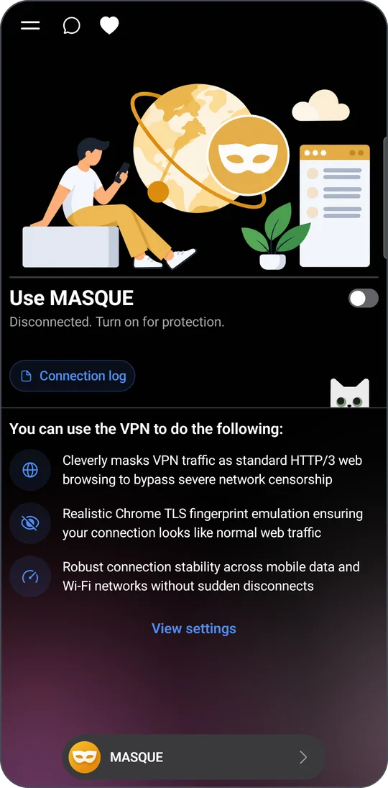
</p>
<p align="center">
  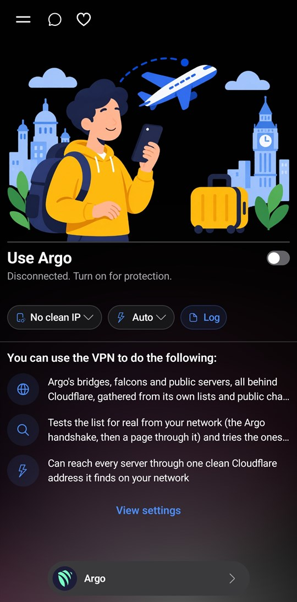
  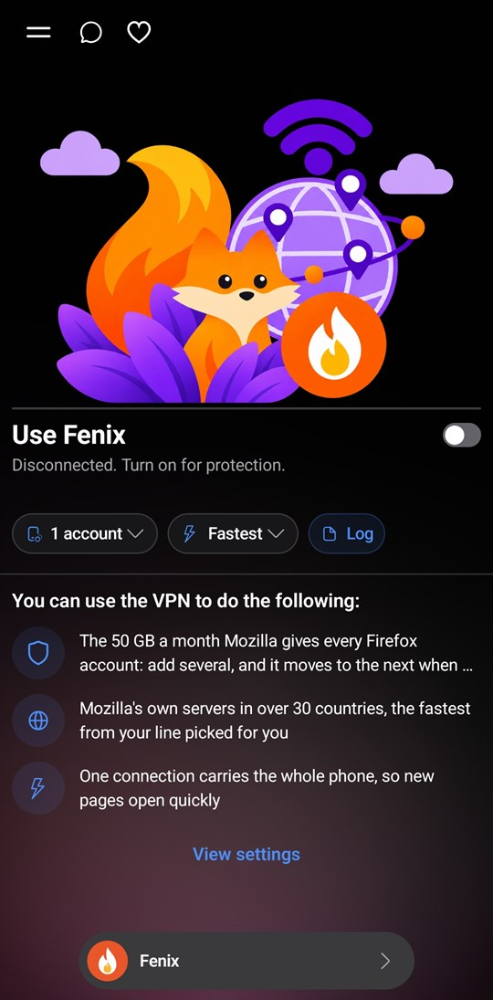
  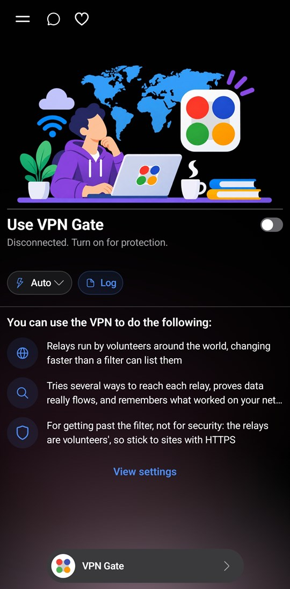
  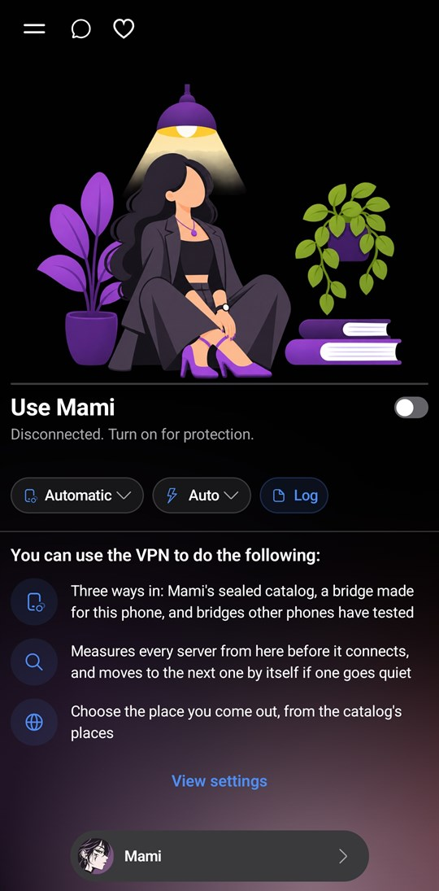
</p>

### Tools that need no server

- **Google relay**: your browser reaches the internet through a Google script you make in your own Google account. Setting it up takes about five minutes; Dr.Net shows the daily quota and warns you before you reach it.
- **Domain fronting**: opens blocked sites such as Google, YouTube and Instagram in Chrome under a clean name. The certificate is made on your phone and its key never leaves it.
- **DNS**: tests dozens of DNS servers on your network (general, anti-sanction, gaming, family…) and connects you through the one you pick.
- Put the tools you use most in the menu with **+**.

<p align="center">
  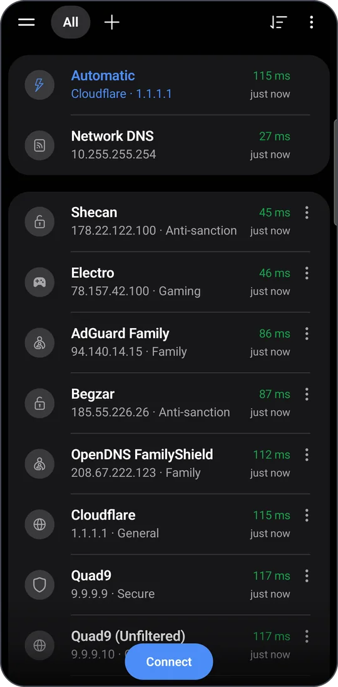
  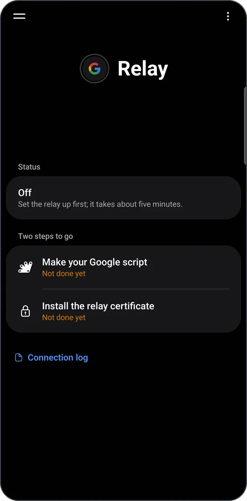
  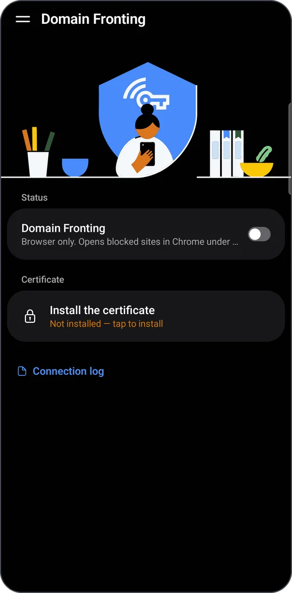
</p>
<p align="center"><sub>DNS test · Google relay · Domain fronting</sub></p>

### Your own configs and servers

- Add your own configs and subscription links, test their real delay, and connect with one tap.
- Build a light, fast worker on **your own** Cloudflare account; your keys stay on your phone.
- Find Cloudflare addresses that work on your network with the clean IP scanner.
- Public free configs are there if you want them, only when you add them yourself.

### Made for every day

- A kill switch that works with every method and config.
- Choose which apps use the tunnel: all apps, only the ones you pick, or all except them (handy for banking apps).
- Reconnect when the connection drops, and connect after a reboot or an update; both stay off until you turn them on.
- A Quick Settings tile, and shortcuts on your home screen.
- A connection log for each method, with data usage by week and month.
- Updates inside the app, even through the tunnel.
- Persian and English, light and dark.

## Install

1. Download the APK for your phone from [Releases](https://github.com/msnuoy/drnet-releases/releases/latest).
2. Open it from your browser's downloads or a file manager. If Android asks, allow installing apps from that source.
3. Tap **Install**, then **Open**.

After that, Dr.Net checks this page itself and offers each new version inside the app.

> [!NOTE]
> Dr.Net is not on Google Play, so Play Protect may offer to scan it or say it doesn't know the developer. That is normal for apps installed from outside the Play Store.

## Make sure your copy is genuine

Modified copies of VPN apps get passed around on Telegram. Download Dr.Net only from this page or through its own updater, and if a file came from anywhere else, check it before you install.

### 1. Checksum

Put `SHA256SUMS.txt` in the same folder as the APK and run one of these. Every file you have must come out `OK`.

**Windows (PowerShell)**

```powershell
Get-Content .\SHA256SUMS.txt | ForEach-Object {
    $hash, $file = $_ -split ' \*'
    if (Test-Path $file) {
        $ok = (Get-FileHash $file -Algorithm SHA256).Hash -eq $hash
        "$file  $(if ($ok) { 'OK' } else { 'FAILED' })"
    }
}
```

**Linux, or Termux on Android**

```bash
sha256sum --check --ignore-missing SHA256SUMS.txt
```

**macOS**

```bash
shasum -a 256 --check --ignore-missing SHA256SUMS.txt
```

### 2. Signing certificate

The APKs on this page are signed with this certificate (`CN=Dr.Net`):

```text
SHA-256: 79:D5:A8:52:56:54:E6:D7:BB:0A:73:FE:46:8C:40:87:E8:BD:F0:B7:5E:5D:D3:59:EC:E3:0D:62:24:B9:1C:AA
```

To check a file, use `apksigner` from the Android SDK build tools:

```bash
apksigner verify --print-certs Dr.Net-*-arm64-v8a.apk
```

The `Signer #1 certificate SHA-256 digest` line must read `79d5a8525654e6d7bb0a73fe468c4087e8bdf0b75e5dd359ece30d6224b91caa`.

Android checks this too: an update installs over your Dr.Net only when it is signed with the same key.

## Privacy

Dr.Net collects nothing about you and sends nothing anywhere.

- No analytics, tracking or ad SDK, and no account.
- No phone identifiers are read: no IMEI, phone number, ANDROID_ID, Google accounts or contacts.
- DNS stays inside the tunnel in every method, and IPv6 cannot slip out beside it.
- The connection log lives only in the app's memory, and release builds do not record site names or addresses in it.
- "Report a problem" opens Telegram with a message you read before sending; links, keys and IDs are removed from it.
- Configs, settings and account keys stay on your phone, encrypted with the Android Keystore, and nothing goes into Google backups.

Every detail, including each address the app itself connects to, is in **[PRIVACY.md](PRIVACY.md)**.

## FAQ

<details>
<summary><b>Is Dr.Net really free?</b></summary>

Yes. There are no ads, no subscription and no account.

</details>

<details>
<summary><b>Which method should I use?</b></summary>

Start with Diagnosis: it shows what is blocked on your network and which way opens it. Dr.Net also remembers which method worked best on each network and shows it at the top of the Diagnosis page.

</details>

<details>
<summary><b>Does it need root?</b></summary>

No. Dr.Net uses Android's standard VPN service, and Android shows a key icon while it is connected.

</details>

<details>
<summary><b>Can anyone see the sites I open?</b></summary>

Not Dr.Net: nothing about your browsing reaches us. As with any VPN, though, the servers of the method you use (Psiphon, Lantern, Tor relays, or public configs) can see which sites you connect to. HTTPS keeps the content of the pages encrypted.

</details>

<details>
<summary><b>Android says "App not installed". What now?</b></summary>

Usually one of three things: the file doesn't match your phone (try armeabi-v7a), the phone is short of storage, or the Dr.Net you already have was signed with a different key. In the last case, back up your configs, uninstall that copy, and install the file from this page.

</details>

<details>
<summary><b>How do I report a problem?</b></summary>

In the app, tap **Report a problem**. Telegram opens with a ready message (phone model, Android version, operator, method and the last lines of the connection log) that you can read before sending. You can also [open an issue](https://github.com/msnuoy/drnet-releases/issues) here.

</details>

## Contact

| | |
| --- | --- |
| Telegram channel | [@NURREVEAL](https://t.me/NURREVEAL): new versions and how-tos |
| YouTube | [@nurreveal](https://www.youtube.com/@nurreveal) |
| Support | [@nurrea](https://t.me/nurrea) on Telegram |
| Bugs and ideas | [Issues](https://github.com/msnuoy/drnet-releases/issues) |

<br>

<div align="center">
<sub>We live with the same internet you do, every day. If Dr.Net helps you, pass it on.</sub>
</div>
